# 🌸 Windots

[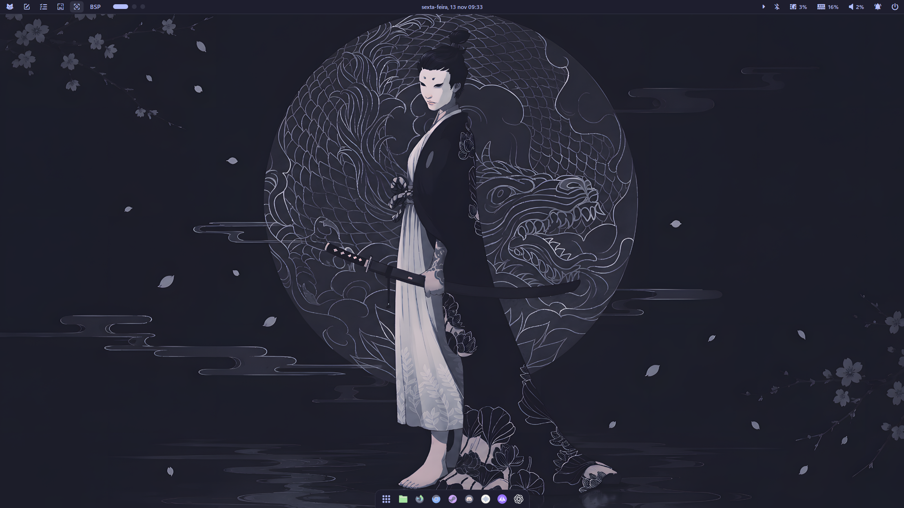](Screenshots/screenshot-1-desktop.png)

### My personal Windows rice & dotfiles

Windows 11 rice based on [Catppuccin Mocha](https://github.com/catppuccin/catppuccin) with lavender accents. Komorebi tiling, custom YASB bar, translucent windows and Windhawk mods.

---

## ✨ About

**Windots** is my collection of Windows rice configs and dotfiles, built around the [Catppuccin Mocha](https://github.com/catppuccin/catppuccin) palette with **Lavender** as the main accent.

The wallpaper is a dark dragon/samurai artwork, the taskbar is styled to float like a dock, and the same colors are used across terminal, bar, context menu and file explorer.

## 🖼️ Screenshots

[](Screenshots/screenshot-1-desktop.png)
[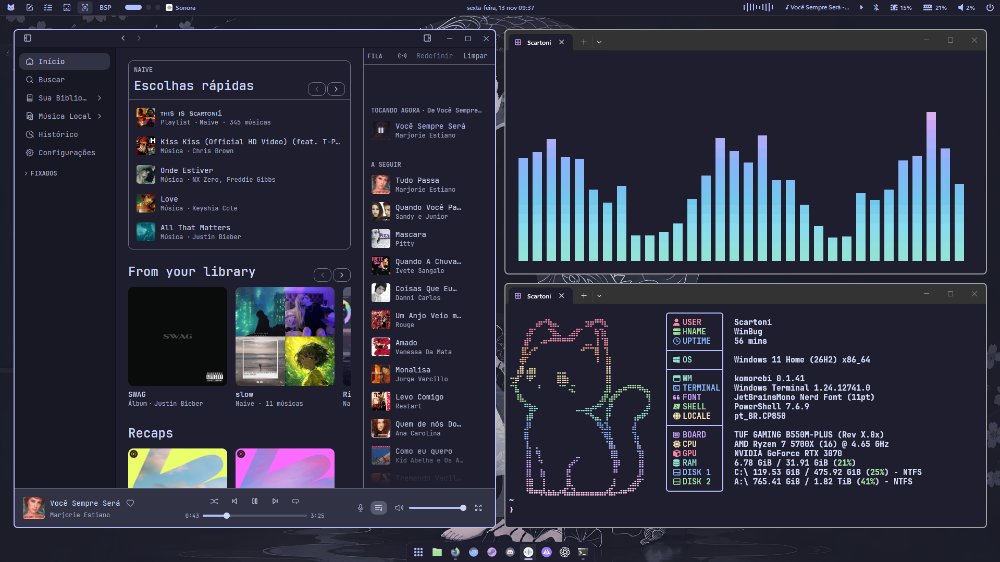](Screenshots/screenshot-2-sonora-fastfetch.png)

[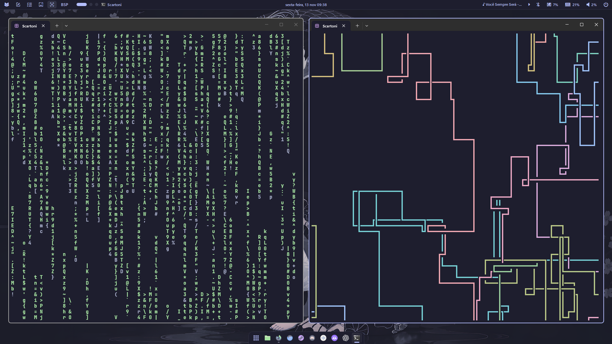](Screenshots/screenshot-3-cava.png)
[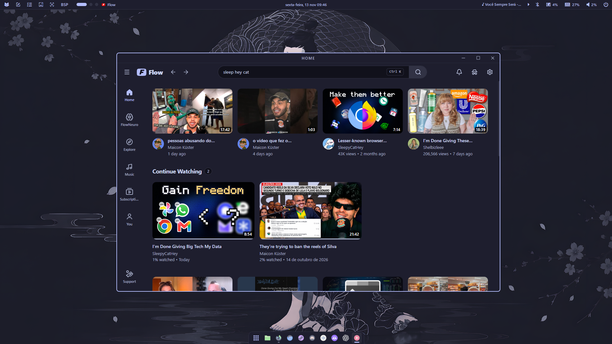](Screenshots/screenshot-4-flow.png)

[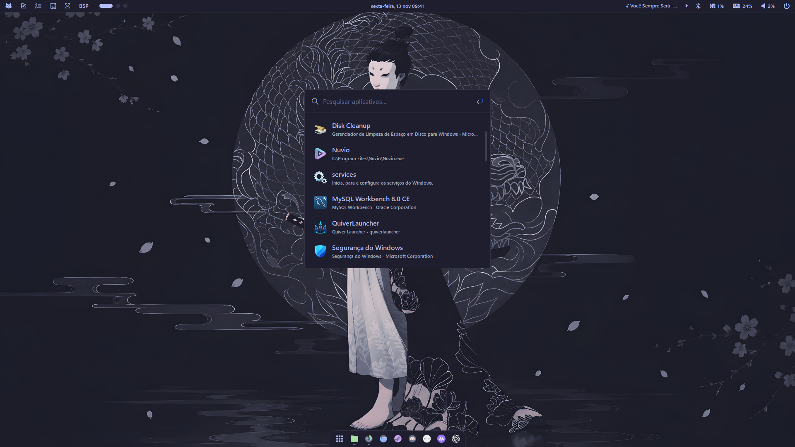](Screenshots/screenshot-6-launcher.png)
[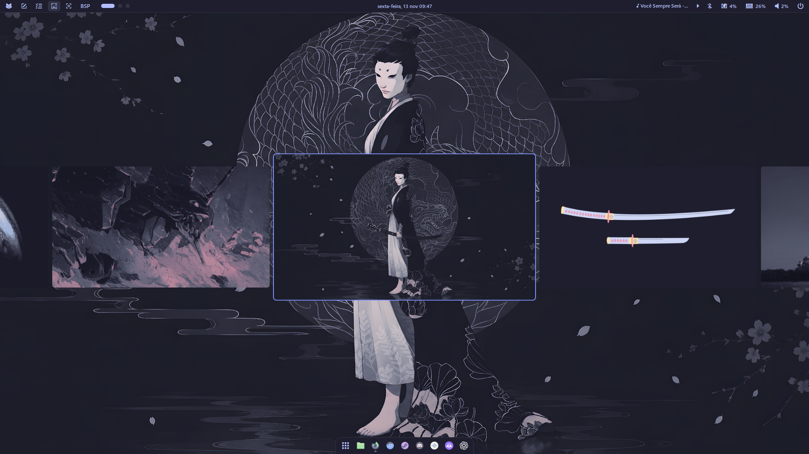](Screenshots/screenshot-9-wallpapers.png)

<details>
<summary>More screenshots</summary>

[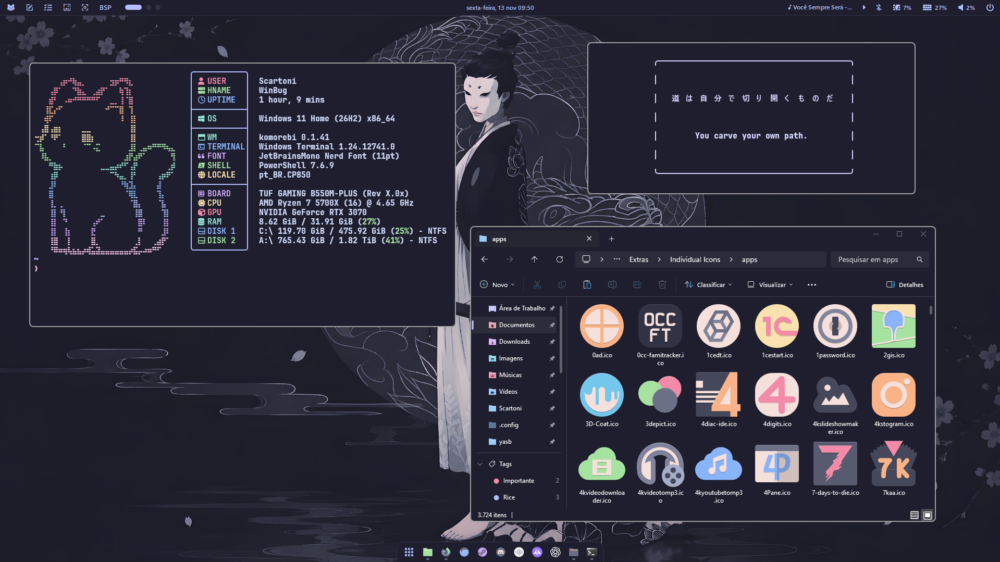](Screenshots/screenshot-5-fastfetch-icons.png)
[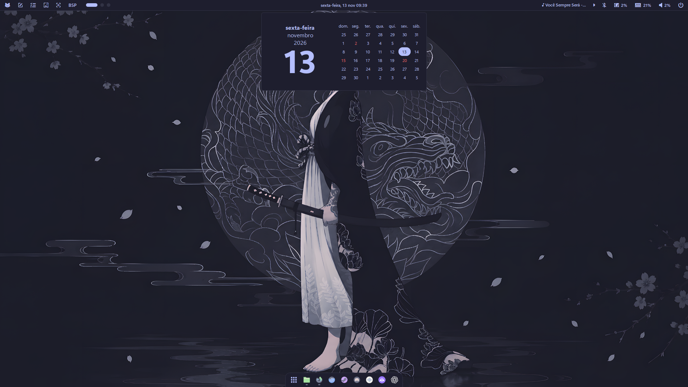](Screenshots/screenshot-7-calendar.png)

[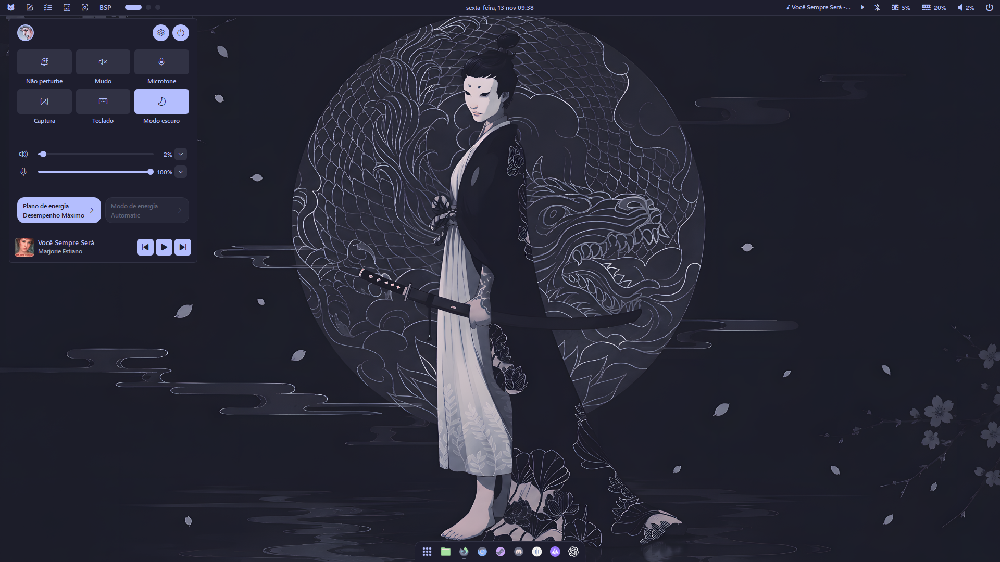](Screenshots/screenshot-8-notification-center.png)
[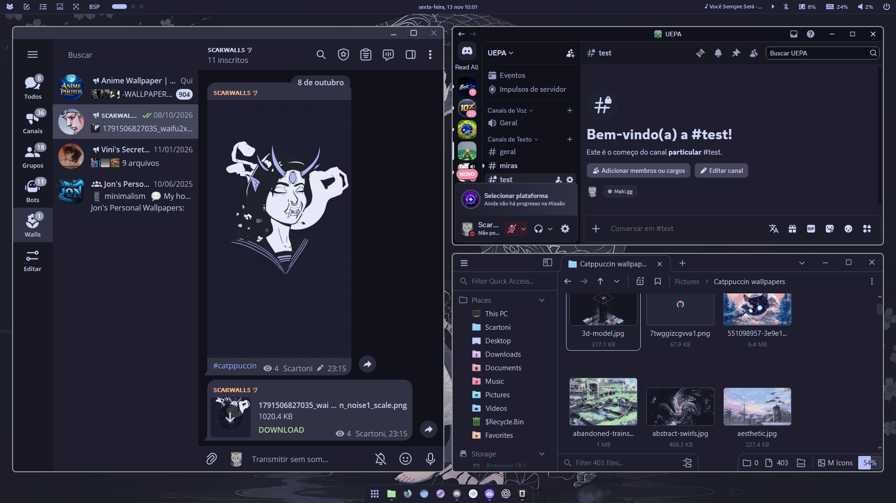](Screenshots/screenshot-10-messaging.png)

[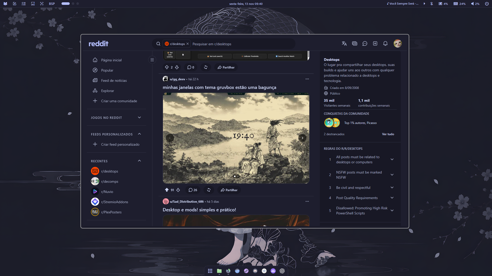](Screenshots/screenshot-11-reddit.png)

</details>

## 🎨 Color Palette

The setup uses **Catppuccin Mocha**, with Lavender as the primary accent.

| Color | Hex | Usage |
| --- | --- | --- |
| Base | `#1e1e2e` | Main background |
| Mantle | `#181825` | Secondary backgrounds |
| Crust | `#11111b` | Deep backgrounds |
| Surface 0 | `#313244` | UI surfaces |
| Surface 1 | `#45475a` | Borders and secondary elements |
| Surface 2 | `#585b70` | Elevated surfaces |
| Text | `#cdd6f4` | Primary text |
| Subtext 0 | `#a6adc8` | Secondary text |
| Lavender | `#b4befe` | Primary accent |
| Blue | `#89b4fa` | Secondary accent |
| Mauve | `#cba6f7` | Highlights |
| Pink | `#f5c2e7` | Additional accents |
| Green | `#a6e3a1` | Success and status indicators |

## 🛠️ Setup

| Component | Configuration |
| --- | --- |
| **Window Manager** | [Komorebi](https://github.com/LGUG2Z/komorebi) — tiling with a bsp-like layout |
| **Desktop Bar** | [YASB](https://github.com/amnweb/yasb) — Catppuccin Mocha theme with wallpaper gallery |
| **Window Borders** | [Tacky Borders](https://github.com/latentcat/tacky-borders) — colored window borders |
| **System Mods** | [Windhawk](https://windhawk.net/) — translucent windows, custom corner radius, dock-like taskbar, start menu & notification center stylers (settings in [`windhawk/`](windhawk/)) |
| **Keybinds** | [whkd](https://github.com/LGUG2Z/whkd) — global keyboard shortcuts |
| **Terminal** | [Windows Terminal](https://github.com/microsoft/terminal) with Catppuccin Mocha theme |
| **Shell** | PowerShell + [Oh My Posh](https://ohmyposh.dev/) with Catppuccin Mocha Lavender theme |
| **System Info** | [Fastfetch](https://github.com/fastfetch-cli/fastfetch) with custom ASCII logo |
| **Audio Visualizer** | [Cava](https://github.com/karlstav/cava) with custom shaders |
| **System Monitor** | [btop](https://github.com/aristocratos/btop) with Catppuccin Mocha theme |
| **Context Menu** | [Nilesoft Shell](https://nilesoft.org/) — customized right-click menu |
| **Browser** | [Zen Browser](https://zen-browser.app/) |
| **Music Player** | [Sonora](https://github.com/sonorahq/sonora) |
| **Messaging** | [Discord](https://discord.com/) + [AyuGram](https://github.com/AyuGram/AyuGram4A) |
| **YouTube** | [Flow](https://github.com/n-ce/Flow) |
| **Font** | [JetBrains Mono Nerd Font](https://www.nerdfonts.com/) |
| **Wallpapers** | [`Catppuccin wallpapers/`](Catppuccin%20wallpapers/) — the full collection shown in the bar's wallpaper gallery |

## 📦 Installation

There's no installer here — these are my personal configs, so take what you need and adapt it.

1. Clone the repository:

```
git clone https://github.com/scartoni/windots.git
```

2. Browse the configuration files and identify the components you want to use.

3. Install the corresponding applications and customization tools.

4. Apply each configuration according to its application's instructions — for example, copy the files from `yasb/` to `%USERPROFILE%\.config\yasb\`, import the Windhawk mod settings from `windhawk/` in the mod's **Advanced** tab, and so on.

> [!IMPORTANT]
> Back up your existing configurations before applying these files. Some modifications may depend on your Windows version, installed applications, or additional customization tools.

## 💜 Credits

- [Catppuccin](https://github.com/catppuccin/catppuccin) — the color palette behind this setup.
- [Komorebi](https://github.com/LGUG2Z/komorebi) & [whkd](https://github.com/LGUG2Z/whkd) — window management and keybinds.
- [YASB](https://github.com/amnweb/yasb) — the desktop bar.
- [Windhawk](https://windhawk.net/) — Windows customization framework.
- [Oh My Posh](https://ohmyposh.dev/) — prompt customization for PowerShell.
- [Fastfetch](https://github.com/fastfetch-cli/fastfetch) — system information tool.

---

**@scartoni**
